# CSE490 (D): Introduction to Football Data & Analytics
## Lecture 1: Course Overview, Football Data Foundations & Statistical Hypothesis Testing

**Instructors:** Tasneem Mazhar | Tanvir Anjum Aditto  
**Department:** Computer Science and Engineering, BRAC University  
**Term:** Spring 2026 / Fall 2026  
**Repository:** [moazzem-hossain-majumder/CSE490D-Introduction-to-Football-Data-Analysis](https://github.com/moazzem-hossain-majumder/CSE490D-Introduction-to-Football-Data-Analysis.git)

---

## Table of Contents
1. [Course Overview & Academic Framework](#1-course-overview--academic-framework)
   - [Course Objectives](#course-objectives)
   - [Course Syllabus & Modules](#course-syllabus--modules)
   - [Assessment & Grading Breakdown](#assessment--grading-breakdown)
   - [Research Project Guidelines & Rubric](#research-project-guidelines--rubric)
   - [Technical Toolchain](#technical-toolchain)
2. [The Modern Football Data Landscape](#2-the-modern-football-data-landscape)
   - [What is Football Analytics?](#what-is-football-analytics)
   - [The Spectrum of Football Data](#the-spectrum-of-football-data)
   - [Event Data vs. Tracking Data vs. 360 Data](#event-data-vs-tracking-data-vs-360-data)
   - [Comparative Analysis Matrix](#comparative-analysis-matrix)
3. [Data Architecture & Coordinate Systems](#3-data-architecture--coordinate-systems)
   - [Pitch Coordinate Standards: StatsBomb vs. WyScout](#pitch-coordinate-standards-statsbomb-vs-wyscout)
   - [StatsBomb Relational Data Hierarchy](#statsbomb-relational-data-hierarchy)
   - [The "Sparsity & NaN" Dilemma in Event Logs](#the-sparsity--nan-dilemma-in-event-logs)
4. [Hands-On Code Walkthrough: StatsBomb Open Data (`Introduction_Statsbomb.ipynb`)](#4-hands-on-code-walkthrough-statsbomb-open-data)
   - [Setup & Libraries](#step-1-environment-setup--library-imports)
   - [Querying Competitions & Matches](#step-2-navigating-the-hierarchy)
   - [Extracting & Parsing Match Events](#step-3-fetching--parsing-match-events)
   - [Coordinate Parsing & Descriptive Statistics](#step-4-coordinate-extraction--normalization)
   - [Visualizing Events on a Pitch Canvas (`mplsoccer`)](#step-5-pitch-visualization-with-mplsoccer)
   - [Shot Map: Goals vs. Non-Goals](#step-6-shot-mapping--outcome-analysis)
   - [Dual-Team Shot Map with Coordinate Flipping](#step-7-dual-team-shot-map--coordinate-flipping)
   - [StatsBomb 360 Freeze Frame: Player Tracking & Camera Coverage](#step-8-statsbomb-360-freeze-frames--spatial-tracking)
   - [Tactical Interpretation of the 360 Freeze Frame](#step-9-tactical-interpretation-of-the-freeze-frame)
5. [Hands-On Code Walkthrough: WyScout Data (`Introduction_Wycout.ipynb`)](#5-hands-on-code-walkthrough-wyscout-data)
   - [WyScout Data Schema & Relational JSON Files](#wyscout-data-schema)
   - [Tag Mapping & Action Filtering](#tag-mapping--action-filtering)
   - [Concatenating Multi-League Event Data](#concatenating-multi-league-event-data)
6. [Mathematical Foundations & Statistical Hypothesis Testing](#6-mathematical-foundations--statistical-hypothesis-testing)
   - [Hypothesis Testing Fundamentals in Sports Analytics](#hypothesis-testing-fundamentals)
   - [Test 1: The Non-Parametric Sign Test (Player Two-Footedness)](#test-1-the-non-parametric-sign-test)
   - [Test 2: One-Sample Student's t-Test (Benchmarking Set Pieces)](#test-2-one-sample-students-t-test)
   - [Test 3: Two-Sample Independent Student's t-Test (Derby Comparison)](#test-3-two-sample-independent-students-t-test)
7. [Comprehensive Practice Problems & Exam Preparation](#7-comprehensive-practice-problems--exam-preparation)
   - [Conceptual Questions & Answers](#conceptual-questions)
   - [Code & Data Debugging Exercises](#code--data-debugging-exercises)
   - [Mathematical & Statistical Problems with Worked Solutions](#mathematical--statistical-problems)
   - [Tactical & Research Scenarios](#tactical--research-scenarios)
8. [References & Supplementary Reading](#8-references--supplementary-reading)

---

## 1. Course Overview & Academic Framework

### Course Objectives
`CSE490(D): Introduction to Football Data & Analytics` bridges computer science, data engineering, spatial statistics, and football tactics. By the conclusion of the course, students are expected to:
1. **Apply Computational & Statistical Methods:** Formulate and solve domain-specific sports problems using data-driven pipelines.
2. **Master Real-World Data Workflows:** Extract, clean, transform, and model semi-structured event and spatial tracking data.
3. **Develop Predictive & Spatial Models:** Build advanced metrics including Expected Goals ($xG$), Pitch Control, Passing Networks, and Action Valuation models.
4. **Conduct Rigorous Academic Research:** Perform independent sports analytics research following rigorous scientific methodologies and ethical guidelines.

```
                          CSE490D Course Roadmap
=============================================================================
[ Module 1: Data Foundations & Visualization ]
  ├── Event Data Architectures (StatsBomb, WyScout, Opta)
  ├── Pitch Coordinate Geometries & Spatial Transformations
  └── Passing Networks, Centrality Metrics & Team Topology
                     │
                     ▼
[ Module 2: Statistical Models & Expected Goals (xG) ]
  ├── Feature Engineering: Shot Angle, Distance, Body Part, Assist Type
  ├── Binary Classification: Logistic Regression, XGBoost, CatBoost
  └── Model Evaluation: ROC-AUC, Brier Score, Calibration Curves
                     │
                     ▼
[ Module 3: Player & Action Valuation ]
  ├── Expected Threat (xT) & Markov Chains
  ├── Valuing Actions by Estimating Probabilities (VAEP)
  └── Radar Charts, Z-Score Normalization & Player Scouting Profiles
                     │
                     ▼
[ Module 4: Uncertainty, Prediction & Trends ]
  ├── Randomness & Variance in Low-Scoring Sports (Poisson Processes)
  ├── Team KPIs, Rolling Averages, and Pythogorean Expectations
  └── Regression to the Mean & Simulation Models
                     │
                     ▼
[ Module 5: Space Control & Player Movement ]
  ├── Voronoi Diagrams & Delaunay Triangulation
  ├── Potential Field Models & Physics-Based Pitch Control (Spearman, 2018)
  └── Off-ball Runs, Pressure Indices, and Defensive Compactness
                     │
                     ▼
[ Module 6: Physical Data & Clustering Techniques ]
  ├── Wearable GPS & High-Speed Running (HSR) Metrics
  ├── Unsupervised Learning: K-Means, DBSCAN, Gaussian Mixture Models
  └── Tactical Playing Style Segmentation & Dimensionality Reduction (PCA, UMAP)
=============================================================================
```

### Assessment & Grading Breakdown
The course emphasizes continuous evaluation, rigorous modeling, and peer-reviewed research deliverables:

| Assessment Component | Weight | Key Expectations |
| :--- | :---: | :--- |
| **Research Project** | **25%** | Team-based scientific paper using open/proprietary football datasets. |
| **Midterm Examination** | **20%** | Theoretical concepts, data structures, coordinate math, and statistical tests. |
| **Final Examination** | **20%** | Comprehensive modeling, pitch control mathematics, and advanced analytics. |
| **Quiz** | **10%** | Unannounced short assessments testing notebook implementations and syntax. |
| **Mini Case Study** | **10%** | Applied industry-style analytics brief (e.g., set-piece optimization). |
| **Research Presentation** | **10%** | Oral defense of project methodology, validation, and tactical findings. |
| **Attendance & Participation**| **5%** | Active engagement in lab walkthroughs and discussion. |
| **Total** | **100%** | |

### Research Project Guidelines & Rubric
The project is executed in teams of **4 students** utilizing open data (StatsBomb, WyScout, Metrica Sports, or Sportec).

```
Project Grade Weight Distribution (Total: 25% of Course)
┌────────────────────────────────────────────────────────┐
│ Methodology (20%) + Analysis & Validation (25%) = 45%  │  <-- Technical Core
├────────────────────────────────────────────────────────┤
│ Problem Formulation (15%) + Literature Review (15%)    │  <-- Context & Novelty
├────────────────────────────────────────────────────────┤
│ Communication & Defense (15%) + Ethics (10%)           │  <-- Rigor & Integrity
└────────────────────────────────────────────────────────┘
```

- **Problem Formulation (15%):** Specificity of the football research question (e.g., *"Quantifying counter-pressing efficiency in transitional moments"*).
- **Literature Review (15%):** Thorough synthesis of existing peer-reviewed literature (e.g., Sloan Sports Analytics, MIT, Sumpter, Bornn, Cervone).
- **Methodology & Modeling (20%):** Sound mathematical formulations, algorithmic correctness, and baseline comparisons.
- **Analysis & Empirical Validation (25%):** Cross-validation, bootstrapping, calibration plots, and out-of-sample testing.
- **Ethics & Limitations (10%):** Addressing selection bias, survivor bias, data leakage, and athlete privacy.
- **Communication & Reporting (15%):** Reproducible code repository, clarity of visual artifacts, and executive summary.

### Technical Toolchain
- **Core Language:** Python 3.10+
- **Numerical Computing & Dataframes:** `pandas`, `numpy`
- **Visualization & Football Pitches:** `matplotlib`, `seaborn`, `mplsoccer`
- **Statistical Modeling:** `scipy.stats`, `statsmodels`
- **Football Data APIs:** `statsbombpy`, WyScout Open JSONs

---

## 2. The Modern Football Data Landscape

### What is Football Analytics?
Historically, football analysis relied on subjective qualitative observation (human scouting reports) and crude aggregated tally metrics (e.g., total shots, raw possession percentage, pass completion rate). These aggregated tallies often deceive because:
1. **Low Event Frequency:** Football is a low-scoring sport where a single fluke event can decide an entire match outcome.
2. **Context Blindness:** A pass completed in one's own penalty box under zero pressure is weighted equally to a line-breaking through-ball that creates a $1\text{v}1$ against the keeper.
3. **Spatial Ignorance:** Aggregate statistics discard coordinates $(x, y)$, shot velocity, player body angles, and passing lanes.

Modern football analytics treats matches as **continuous spatial-temporal point processes**, modeling actions based on location, pressure, expected probabilities, and spatial dominance.

### The Spectrum of Football Data

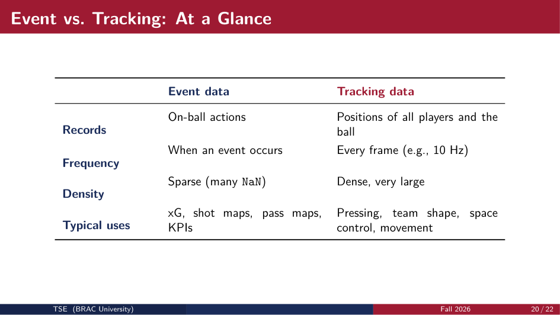

Modern football data is categorized into three primary layers:
1. **Event Data:** Manual or semi-automated logging of on-ball interactions (shots, passes, tackles, dribbles, fouls) with spatial timestamps.
2. **Tracking Data:** High-frequency optical or GPS recording of all 22 players and the ball across all 90+ minutes.
3. **Broadcast Tracking / 360 Data:** Event-synchronized snapshots of all players captured within the television broadcast camera frustum at the precise moment of an on-ball action.

### Event Data vs. Tracking Data vs. 360 Data

```
Data Granularity & Cost Spectrum
◄────────────────────────────────────────────────────────────────────────►
Low Cost / Sparse                                       High Cost / Dense
[ Event Data ] ───────────────► [ StatsBomb 360 ] ──────────────► [ Tracking Data ]
- On-ball only                  - Event synchronized              - All 22 players + ball
- Discrete occurrences          - Contextual freeze-frame         - Continuous (10-25 Hz)
- ~3,000 events / match         - Visible area polygon            - ~3.5 million records / match
- Primary: xG, shot/pass maps   - Primary: Line breaks, pressure  - Primary: Pitch control, shape
```

### Comparative Analysis Matrix

| Feature Dimension | Event Data | StatsBomb 360 Data | Full Tracking Data |
| :--- | :--- | :--- | :--- |
| **Observed Objects** | Only the player executing the ball event (+ receiver/tackler). | Event actor + all visible teammates/opponents within camera view. | All 22 players, substitutes, referees, and the ball continuously. |
| **Temporal Frequency** | Discrete (logged only when an on-ball action occurs, ~3,000/game). | Discrete (captured at the specific millisecond timestamp of an event). | Continuous (10 Hz to 25 Hz; 10–25 frames per second). |
| **Spatial Density** | Sparse coordinates; $(x, y)$ recorded at event origin and terminus. | Semi-dense freeze frames with $(x, y)$ coordinates and visible polygon. | Hyper-dense spatial trajectories ($x, y, z$ coordinates for 90+ minutes). |
| **Typical Data Volume** | ~2 MB to 5 MB per match (JSON). | ~15 MB to 30 MB per match (JSON). | ~1.5 GB to 5 GB per match (raw CSV/DAT). |
| **Capture Technology** | Human taggers using video annotation software. | Computer vision applied to standard broadcast television feeds. | Multi-camera optical tracking systems (TRACAB, Second Spectrum) or GPS. |
| **Primary Use Cases** | Expected Goals ($xG$), passing sonars, shot charts, player scouting. | Line-breaking passes, defensive block compactness, pass availability under pressure. | Pitch control models, high-speed running metrics, pressing efficiency, tactical spacing. |
| **Key Limitation** | Completely blind to off-ball runs, defensive cover, and team shape. | Limited to the broadcast camera frustum (players off-screen are unobserved). | Expensive, proprietary, and inaccessible for open academic research. |

---

## 3. Data Architecture & Coordinate Systems

### Pitch Coordinate Standards: StatsBomb vs. WyScout

A fundamental requirement when merging or analyzing football data is understanding that **different data providers use distinct coordinate systems**.

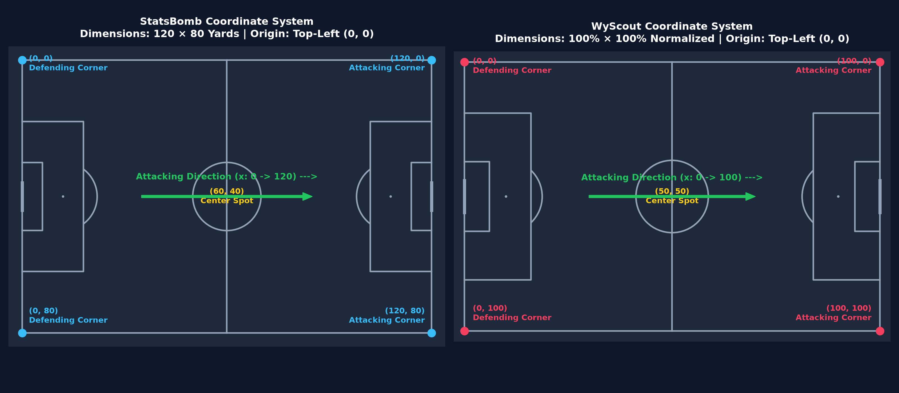

#### 1. StatsBomb Coordinate System
- **Unit of Measurement:** **Yards** (fixed dimensions: $120 \times 80$ yards).
- **Origin $(0, 0)$:** Top-Left corner flag of the attacking team's defending half.
- **X-axis Range:** $[0, 120]$ yards (length of pitch).
  - $x = 0$: Defending goal-line.
  - $x = 60$: Center-line.
  - $x = 120$: Opponent's goal-line (attacking target).
- **Y-axis Range:** $[0, 80]$ yards (width of pitch).
  - $y = 0$: Top touchline (left flank from attacker perspective).
  - $y = 40$: Center spot / goal center.
  - $y = 80$: Bottom touchline (right flank from attacker perspective).
- **Penalty Box Dimensions:** Attacking penalty box spans $x \in [102, 120]$ and $y \in [18, 62]$. The goal sits at $x = 120, y \in [36, 44]$.

#### 2. WyScout Coordinate System
- **Unit of Measurement:** **Normalized Percentages** ($[0, 100] \times [0, 100]$).
- **Origin $(0, 0)$:** Top-Left corner flag.
- **X-axis Range:** $[0, 100]\%$.
  - $x = 0$: Defending goal-line.
  - $x = 50$: Center-line.
  - $x = 100$: Attacking goal-line.
- **Y-axis Range:** $[0, 100]\%$.
  - $y = 0$: Top touchline.
  - $y = 50$: Center line.
  - $y = 100$: Bottom touchline.

#### Coordinate Conversion Mathematical Formula
To transform WyScout normalized percentage coordinates $(x_w, y_w)$ into StatsBomb standard yards $(x_{sb}, y_{sb})$:
$$x_{sb} = \frac{x_w}{100} \times 120 = 1.2 \times x_w$$
$$y_{sb} = \frac{y_w}{100} \times 80 = 0.8 \times y_w$$

Conversely, to convert StatsBomb yards to WyScout percentages:
$$x_w = \frac{x_{sb}}{120} \times 100 = \frac{x_{sb}}{1.2}$$
$$y_w = \frac{y_{sb}}{80} \times 100 = \frac{y_{sb}}{0.8}$$

### StatsBomb Relational Data Hierarchy

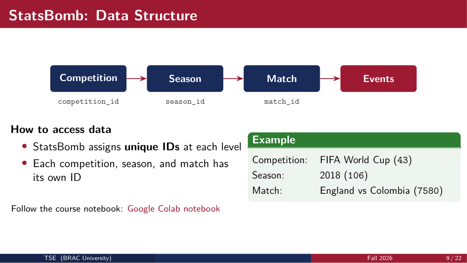

StatsBomb organizes match metadata and action logs in a strict relational hierarchy linked by foreign key identifiers:

```
[ Competitions ] (competition_id: 43 -> FIFA World Cup)
       │
       ▼
[ Seasons ] (season_id: 106 -> 2022)
       │
       ▼
[ Matches ] (match_id: 3857289 -> Serbia vs Switzerland)
       │
       ├──────────────────────────────┐
       ▼                              ▼
[ Events DataFrame ]         [ 360 Frames DataFrame ]
  - id (UUID)                  - id (Foreign Key -> event_id)
  - timestamp, minute, second  - timestamp
  - type: 'Pass', 'Shot', etc. - visible_area: [x1, y1, x2, y2, ...]
  - location: [x, y]           - freeze_frame: [{x, y, actor, keeper, ...}]
  - player_id, team_id
```

Each tier contains unique keys:
- `competition_id`: Uniquely identifies the tournament (e.g., $43$ = FIFA World Cup, $11$ = La Liga, $2$ = Premier League).
- `season_id`: Identifies the competition season (e.g., $106$ = 2022 / 2018, $90$ = 2020/2021).
- `match_id`: Identifies a single 90-minute encounter.
- `id` (Event UUID): The primary key for each granular action on the pitch.

### The "Sparsity & NaN" Dilemma in Event Logs

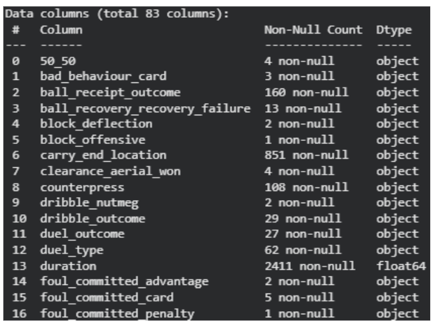

When loading StatsBomb event data into a flattened Pandas DataFrame (`sb.events(match_id)`), an immediate observation is that **most columns contain `NaN` (missing) values**.

#### Why is the DataFrame Sparse?
Football event data exhibits **event polymorphism**. While every event shares generic metadata (timestamp, player, team, event type, location coordinates), specialized attributes are mutually exclusive:
- A `Shot` has attributes: `shot_end_location`, `shot_technique`, `shot_body_part`, `shot_statsbomb_xg`, `shot_outcome`.
- A `Pass` has attributes: `pass_length`, `pass_angle`, `pass_recipient`, `pass_height`, `pass_switch`.
- A `Foul Committed` has attributes: `foul_committed_card`, `foul_committed_offensive`.
- A `Goalkeeper` event has attributes: `goalkeeper_position`, `goalkeeper_type`.

In a unified flat tabular schema containing $\approx 120$ columns:
- A `Pass` row will have `NaN` for all 25+ `shot_*` columns.
- A `Shot` row will have `NaN` for all 20+ `pass_*` columns.
- A `Tackle` row will have `NaN` for both `shot_*` and `pass_*` columns.

> [!NOTE]
> In tabular football databases, high sparsity is not an indication of missing or corrupted data; it is the structural consequence of unnesting polymorphic JSON action objects into a 2D relational table.

---

## 4. Hands-On Code Walkthrough: StatsBomb Open Data

This section breaks down the official course notebook [`Introduction_Statsbomb.ipynb`](file:///d:/CSE490D/Lecture%201/Introduction_Statsbomb.ipynb) line-by-line.

### Step 1: Environment Setup & Library Imports

```python
# Install official StatsBomb API wrapper and football pitch plotting engine
!pip install statsbombpy mplsoccer

import pandas as pd
import numpy as np
import matplotlib.pyplot as plt

from statsbombpy import sb
from mplsoccer import Pitch

# Display all columns without truncation in Jupyter/Colab
pd.set_option('display.max_columns', None)
```

- `statsbombpy`: Python client that fetches free open data directly from StatsBomb's public GitHub repository via high-speed API endpoints.
- `mplsoccer`: Specialized Matplotlib wrapper designed specifically for sports spatial data, handling pitch drawing, heatmaps, passing sonars, and convex hulls.

### Step 2: Navigating the Hierarchy

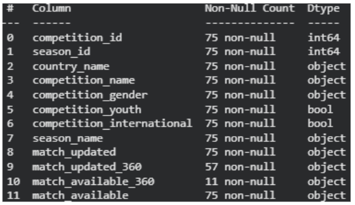

```python
# 1. Fetch all accessible open competitions
competitions = sb.competitions()
competitions.info()
display(competitions.head())
```

To isolate a specific tournament, we perform boolean filtering on the competition DataFrame:

```python
# Filter for FIFA World Cup 2018
wc = competitions[(competitions['competition_name'] == 'FIFA World Cup') &
                  (competitions['season_name'] == '2018')]

competition_id = wc.iloc[0]['competition_id'] # Returns 43
season_id = wc.iloc[0]['season_id']           # Returns 3
```

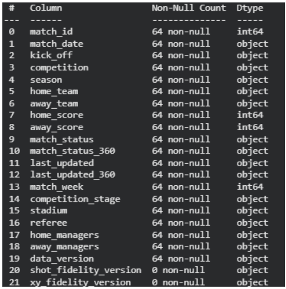

Next, we pull all matches within this competition and season:

```python
# 2. Query all matches for 2018 FIFA World Cup
matches = sb.matches(competition_id=competition_id, season_id=season_id)
print(f"Total matches in tournament: {matches.shape[0]}")
display(matches[['match_id', 'match_date', 'home_team', 'away_team', 'home_score', 'away_score']].head())

# Select a target match: England vs Colombia (Round of 16)
match_id = 7580
```

### Step 3: Fetching & Parsing Match Events

```python
# 3. Pull all event logs for England vs Colombia
events = sb.events(match_id=match_id)
print(f"Total events recorded: {len(events)}")
print(f"Total columns in event DataFrame: {events.shape[1]}")
```

### Step 4: Coordinate Extraction & Normalization
In raw StatsBomb data, pitch coordinates are packed as a Python list inside a single column: `location = [x, y]`. To compute distances, build models, or plot scatter points, we unpack this column into separate float series:

```python
# Unpack [x, y] list into distinct float columns
events['x'] = events['location'].apply(
    lambda loc: loc[0] if isinstance(loc, list) and len(loc) == 2 else np.nan
)
events['y'] = events['location'].apply(
    lambda loc: loc[1] if isinstance(loc, list) and len(loc) == 2 else np.nan
)

# Inspect coordinate distribution
print(events[['x', 'y']].describe())
```

- Expected ranges: $x \in [0, 120]$, $y \in [0, 80]$.
- Actions lacking coordinates (e.g., Tactical Subsitutions, Off-field Red Cards) evaluate to `NaN` and are safely ignored during spatial plotting.

### Step 5: Pitch Visualization with `mplsoccer`

```python
# Initialize a StatsBomb standard pitch
pitch = Pitch(pitch_type='statsbomb', pitch_color='#141e30', line_color='#64748b')
fig, ax = pitch.draw(figsize=(10, 7))

# Scatter all event points across the 90 minutes
pitch.scatter(
    events['x'], events['y'],
    s=5,
    alpha=0.3,
    color='#38bdf8',
    ax=ax
)

ax.set_title('Spatial Distribution of All On-Ball Events (England vs Colombia)', 
             fontsize=14, color='white', pad=12)
plt.show()
```

### Step 6: Shot Mapping & Outcome Analysis

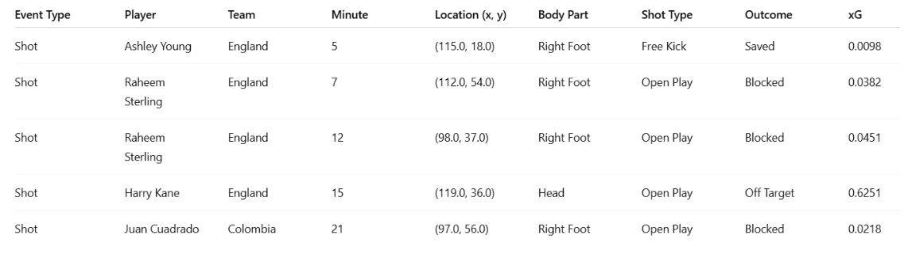

Filtering solely for shot attempts drops irrelevant event columns and isolates goal-scoring opportunities:

```python
# Filter for shot events
shots = events[events['type'] == 'Shot'].copy()

# Identify columns populated specifically for shots (excluding NaNs)
non_nan_columns = shots.columns[shots.notna().all()].tolist()
print(f"Features universally populated for shots: {non_nan_columns}")
print(shots['shot_outcome'].value_counts())
```

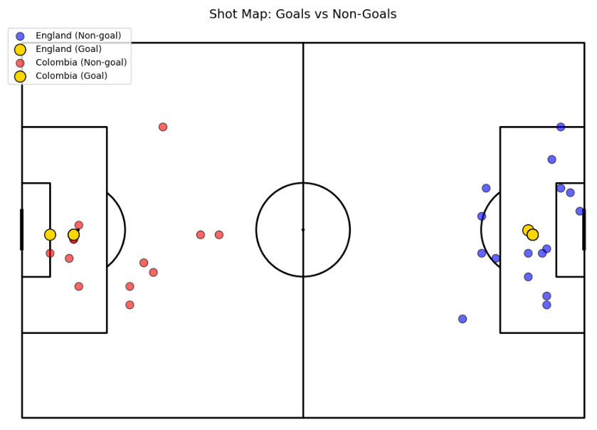

```python
# Plot Shots: Goals vs Non-Goals
fig, ax = pitch.draw(figsize=(10, 7))

pitch.scatter(
    shots['x'], shots['y'],
    c=(shots['shot_outcome'] == 'Goal'),
    cmap='coolwarm', # Blue for Non-Goal, Red for Goal
    s=120,
    edgecolor='black',
    ax=ax
)

ax.set_title('Shot Map: Goals (Red) vs. Non-Goals (Blue)', fontsize=14)
plt.show()
```

### Step 7: Dual-Team Shot Map & Coordinate Flipping

In the standard single-pitch view above, both teams attack towards the right goal ($x = 120$). This causes the shots of both teams to overlap inside the same penalty box, making it impossible to evaluate team territorial dominance.

To produce an intuitive match summary, we **flip the coordinates of the away team** so that:
- **Home Team (England):** Attacks from Left to Right (target goal at $x = 120$).
- **Away Team (Colombia):** Attacks from Right to Left (target goal at $x = 0$).

#### Mathematical Coordinate Flipping Formula
Since the StatsBomb pitch length is $L = 120$ yards:
$$x_{\text{flipped}} = 120 - x_{\text{original}}$$
$$y_{\text{flipped}} = 80 - y_{\text{original}} \quad \text{(optional, flips flanks as well)}$$

In the course notebook, only the X-axis is inverted (`away_shots['x'] = 120 - away_shots['x']`):

```python
fig, ax = pitch.draw(figsize=(14, 8))
fig.set_facecolor('#0b1120')

teams = shots['team'].unique()
home_team, away_team = teams[0], teams[1]

home_shots = shots[shots['team'] == home_team].copy()
away_shots = shots[shots['team'] == away_team].copy()

# Flip away team shots to attack right-to-left
away_shots['x'] = 120 - away_shots['x']

# 1. Plot Home Team Non-Goals
pitch.scatter(
    home_shots.loc[home_shots['shot_outcome'] != 'Goal', 'x'],
    home_shots.loc[home_shots['shot_outcome'] != 'Goal', 'y'],
    color='#38bdf8', s=90, alpha=0.75, edgecolor='white', ax=ax, label=f"{home_team} (Non-Goal)"
)

# 2. Plot Home Team Goals
pitch.scatter(
    home_shots.loc[home_shots['shot_outcome'] == 'Goal', 'x'],
    home_shots.loc[home_shots['shot_outcome'] == 'Goal', 'y'],
    color='#facc15', s=220, edgecolor='black', ax=ax, label=f"{home_team} (GOAL!)", zorder=5
)

# 3. Plot Away Team Non-Goals
pitch.scatter(
    away_shots.loc[away_shots['shot_outcome'] != 'Goal', 'x'],
    away_shots.loc[away_shots['shot_outcome'] != 'Goal', 'y'],
    color='#f43f5e', s=90, alpha=0.75, edgecolor='white', ax=ax, label=f"{away_team} (Non-Goal)"
)

# 4. Plot Away Team Goals
pitch.scatter(
    away_shots.loc[away_shots['shot_outcome'] == 'Goal', 'x'],
    away_shots.loc[away_shots['shot_outcome'] == 'Goal', 'y'],
    color='#10b981', s=220, edgecolor='black', ax=ax, label=f"{away_team} (GOAL!)", zorder=5
)

ax.set_title(f"FIFA World Cup 2018: {home_team} vs {away_team}\nDual Shot Map with Inverted Attacking Orientations", 
             fontsize=15, color='white', fontweight='bold', pad=15)
ax.legend(loc='lower center', bbox_to_anchor=(0.5, -0.09), ncol=4, facecolor='#1e293b', edgecolor='#475569', labelcolor='white')
plt.show()
```

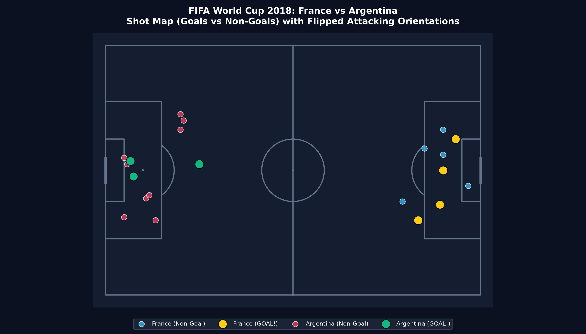

### Step 8: StatsBomb 360 Freeze Frames & Spatial Tracking

StatsBomb 360 provides a freeze-frame snapshot at the moment an event occurs.

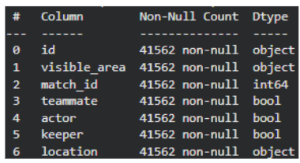
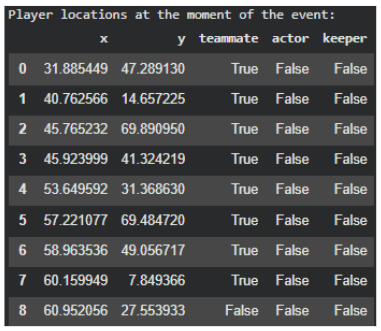

```python
# Query 360 frames for a match (e.g., Serbia vs Switzerland, World Cup 2022)
matches = sb.matches(competition_id=43, season_id=106)
match = matches.iloc[0]
match_id = match['match_id']

events = sb.events(match_id=match_id)
frames = sb.frames(match_id=match_id)

# Isolate the first recorded 360 event frame
event_id = frames["id"].iloc[0]
df_frame = frames.loc[frames["id"] == event_id].copy()

# Unpack player locations
coords = df_frame["location"].apply(lambda loc: pd.Series(loc, index=["x", "y"]))
df_frame.loc[:, ["x", "y"]] = coords

print("360 Freeze Frame Player Registry:")
display(df_frame[["x", "y", "teammate", "actor", "keeper"]])
```

#### Unpacking the Camera Frustum (`visible_area`)
The column `visible_area` is a 1D list of alternating $(x, y)$ coordinate pairs defining the convex polygon captured by the television broadcast camera:
$$\text{visible\_area} = [x_1, y_1, x_2, y_2, x_3, y_3, \dots, x_k, y_k]$$

To plot this polygon using Matplotlib's `ax.fill()`:
```python
va = df_frame["visible_area"].iloc[0]
va_x = va[0::2] # Slices elements at index 0, 2, 4, ... (all X coordinates)
va_y = va[1::2] # Slices elements at index 1, 3, 5, ... (all Y coordinates)
```

#### Visualizing the 360 Pitch

```python
pitch = Pitch(pitch_type="statsbomb", pitch_color="#141e30", line_color="#64748b")
fig, ax = pitch.draw(figsize=(12, 7.5))
fig.set_facecolor('#0b1120')

# 1. Fill the Camera Coverage Frustum
ax.fill(va_x, va_y, color="#38bdf8", alpha=0.3, label="Camera Visible Polygon")

# 2. Split players by tactical role
teammates = df_frame[(df_frame["teammate"]) & (~df_frame["actor"])]
opponents = df_frame[~df_frame["teammate"]]
actor = df_frame[df_frame["actor"]]

# 3. Scatter player positions
pitch.scatter(teammates["x"], teammates["y"], color="#38bdf8", s=110, ax=ax, label="Teammates", edgecolor='white')
pitch.scatter(opponents["x"], opponents["y"], color="#f43f5e", s=110, ax=ax, label="Opponents", edgecolor='white')
pitch.scatter(actor["x"], actor["y"], color="#facc15", edgecolors="black", s=220, ax=ax, label="Event Actor (Ball Carrier)", zorder=5)

ax.legend(loc="upper left", facecolor='#1e293b', edgecolor='#475569', labelcolor='white')
ax.set_title("StatsBomb 360 Freeze Frame: Player Positions & Camera Frustum", fontsize=14, color='white', pad=15)
plt.show()
```

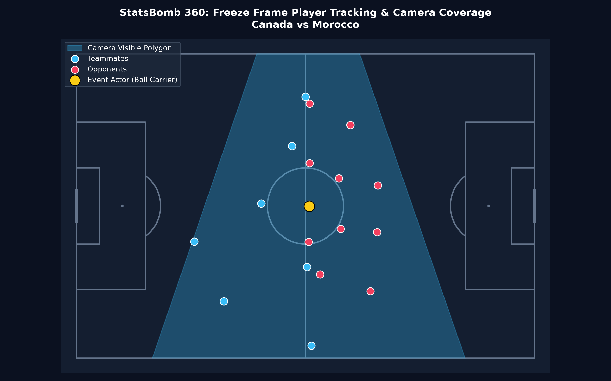
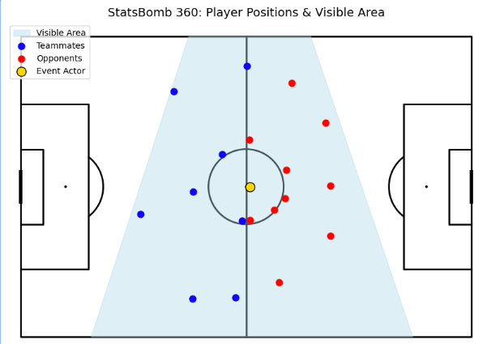

### Step 9: Tactical Interpretation of the Freeze Frame
The slide explicitly prompts: **"What can you observe from this pitch image?"**

A senior football data analyst extracts five critical tactical insights from this visualization:
1. **Camera Frustum Boundary (Selection Bias):** The light blue shaded polygon represents the exact camera visibility. Notice how players outside this boundary (such as the defending goalkeeper or opposite wingers) are unrecorded. Any spatial metric computed on 360 data must account for this boundary to avoid false conclusions regarding player positioning.
2. **Defensive Compactness & Shape:** The red opponent markers form a structured defensive block between the ball and their defending penalty box, maintaining horizontal and vertical compactness.
3. **Passing Lane Occlusion:** Several direct forward passing channels from the event actor (gold marker) to advanced teammates are obstructed by opponent cover shadows.
4. **Numerical Overload:** In the immediate quadrant around the ball carrier, we can compute the local numerical superiority (e.g., $3\text{v}2$ or $4\text{v}3$), indicating pressing intensity.
5. **Event Actor Context:** Unlike pure event data (which records only that a pass or dribble occurred at $(x, y)$), 360 reveals *why* the actor chose that action (e.g., being closed down by an opponent within a 2-yard radius).

---

## 5. Hands-On Code Walkthrough: WyScout Data

This section breaks down the official course notebook [`Introduction_Wycout.ipynb`](file:///d:/CSE490D/Lecture%201/Introduction_Wycout.ipynb).

### WyScout Data Schema
WyScout distributes open match data across distinct relational JSON files:
- `competitions.json`: Tournament metadata (`wyId`, `name`, `format`, `area`).
- `matches/matches_{League}.json`: Fixture details (`matchId`, `teamsData`, `gameweek`, `referees`).
- `players.json`: Biographical data (`wyId`, `shortName`, `role`, `foot`, `currentTeamId`).
- `teams.json`: Club metadata (`wyId`, `name`, `city`, `area`).
- `events/events_{League}.json`: Action events partitioned by competition.
- `eventid2name.csv`: Mapping table translating primary event integer IDs to text (`1` $\to$ Pass, `8` $\to$ Shot, `10` $\to$ Save).
- `tags2name.csv`: Mapping table translating tag integer IDs to action qualifiers (`401` $\to$ Left Foot, `402` $\to$ Right Foot, `101` $\to$ Goal, `1801` $\to$ Accurate).

```python
# Loading WyScout metadata
with open(f"{BASE_PATH}/competitions.json", encoding="utf-8") as f:
    competitions_df = pd.DataFrame(json.load(f))

with open(f"{BASE_PATH}/players.json", encoding="utf-8") as f:
    players_df = pd.DataFrame(json.load(f))

with open(f"{BASE_PATH}/teams.json", encoding="utf-8") as f:
    teams_df = pd.DataFrame(json.load(f)).rename(columns={"wyId": "teamId"})
```

### Tag Mapping & Action Filtering
In WyScout event files, qualitative descriptors (such as whether a shot was taken with the left foot, right foot, or head) are stored inside a nested list of dictionaries called `tags`:
`tags: [{'id': 401}, {'id': 1801}]`

To filter events by tag in Pandas, we apply lambda expressions checking for dictionary membership:

```python
# Identify Son Heung-Min's unique WyScout ID
son_id = players_df.loc[players_df["shortName"] == "Son Heung-Min", "wyId"].iloc[0]

# Filter all shots attempted by Son Heung-Min
son_shots = shots.loc[shots["playerId"] == son_id]

# Tag 401 = Left foot shot
lefty_shots = son_shots.loc[
    son_shots.apply(lambda row: {'id': 401} in row['tags'], axis=1)
]

# Tag 402 = Right foot shot
righty_shots = son_shots.loc[
    son_shots.apply(lambda row: {'id': 402} in row['tags'], axis=1)
]

print(f"Son Heung-Min - Left Foot Shots: {len(lefty_shots)}, Right Foot Shots: {len(righty_shots)}")
```

### Concatenating Multi-League Event Data
WyScout partitions events across individual league JSON files (`events_England.json`, `events_Spain.json`, `events_Italy.json`, etc.). To perform cross-league research:

```python
event_frames = []
for file in os.listdir(f"{BASE_PATH}/events"):
    if file.endswith(".json"):
        with open(f"{BASE_PATH}/events/{file}", encoding="utf-8") as f:
            league_events = json.load(f)
        event_frames.append(pd.DataFrame(league_events))

# Concatenate all leagues into a unified corpus
all_events = pd.concat(event_frames, ignore_index=True)
```

---

## 6. Mathematical Foundations & Statistical Hypothesis Testing

A core objective of `CSE490D` is replacing subjective opinion with formal statistical hypothesis testing. In `Introduction_Wycout.ipynb`, three distinct statistical hypothesis tests are implemented.

### Hypothesis Testing Fundamentals

```
                       Hypothesis Testing Logic Flow
                       ─────────────────────────────
                       1. Formulate Hypotheses:
                          Null (H0) vs. Alternative (H1)
                                    │
                                    ▼
                       2. Set Significance Level (α):
                          Conventionally α = 0.05
                                    │
                                    ▼
                       3. Select Test Statistic:
                          - Discrete / Non-parametric -> Sign Test
                          - Continuous Mean vs. Baseline -> 1-Sample t-Test
                          - Continuous Means (2 Groups) -> 2-Sample t-Test
                                    │
                                    ▼
                       4. Calculate p-value:
                          Probability of observing data under H0
                                    │
                                    ▼
                       5. Decision Rule:
                          - If p < α: Reject H0 (Statistically Significant)
                          - If p >= α: Fail to Reject H0
```

- **Null Hypothesis ($H_0$):** The default presumption of no effect, no difference, or fair parity (e.g., *"The player is equally likely to shoot with left or right foot"*).
- **Alternative Hypothesis ($H_1$ or $H_a$):** The research claim indicating a significant difference or bias.
- **Significance Level ($\alpha$):** The threshold probability of committing a Type I error (rejecting $H_0$ when $H_0$ is true). Standard in football analytics: $\alpha = 0.05$.
- **$p$-value:** The probability of obtaining test results at least as extreme as the observed results, assuming $H_0$ is true.

---

### Test 1: The Non-Parametric Sign Test

#### Research Question
*Is Tottenham Hotspur forward Son Heung-Min genuinely "two-footed" (ambipedal), or does he exhibit a statistically significant preference for one foot when shooting?*

#### Why the Sign Test?
The outcome of each shot's striking foot is **binary/categorical** (Left Foot vs. Right Foot). We cannot assume a continuous normal distribution. The **Sign Test** is a non-parametric test based on the **Binomial Distribution**.

#### Mathematical Formulation
Let:
- Success ($+1$): Shot taken with the Left Foot.
- Failure ($-1$): Shot taken with the Right Foot.
- $p$: True underlying probability of shooting with the Left Foot.
- $n$: Total number of footed shots ($n = n_{\text{left}} + n_{\text{right}}$).
- $k$: Number of observed Left-Foot shots ($k = n_{\text{left}}$).

Under the Null Hypothesis:
$$H_0: p = 0.5 \quad \text{(Equally likely to shoot with either foot / ambipedal)}$$
$$H_1: p \neq 0.5 \quad \text{(Statistically significant foot preference; two-tailed)}$$

Under $H_0$, the random variable $X$ representing the count of left-foot shots follows a Binomial distribution:
$$X \sim \text{Binomial}(n, p = 0.5)$$
The probability of observing exactly $i$ left-foot shots is given by:
$$P(X = i) = \binom{n}{i} (0.5)^i (1 - 0.5)^{n - i} = \binom{n}{i} (0.5)^n$$

The **two-tailed $p$-value** is computed as:
$$p\text{-value} = 2 \times \min\left( P(X \le k), P(X \ge k) \right)$$
Where the cumulative lower tail is:
$$P(X \le k) = \sum_{i=0}^{k} \binom{n}{i} (0.5)^n$$

#### Python Implementation (`Introduction_Wycout.ipynb`)
```python
from statsmodels.stats.descriptivestats import sign_test

# Encode: +1 for Left Foot, -1 for Right Foot
shot_data = [1] * len(lefty_shots)
shot_data.extend([-1] * len(righty_shots))

# Perform two-tailed Sign Test against median mu0 = 0
test_stat, p_value = sign_test(shot_data, mu0=0)
print(f"Sign Test: Test Statistic = {test_stat}, p-value = {p_value:.4f}")

if p_value < 0.05:
    print("Reject H0: Son Heung-Min exhibits a statistically significant foot preference.")
else:
    print("Fail to Reject H0: No statistically significant difference. Son is genuinely two-footed!")
```

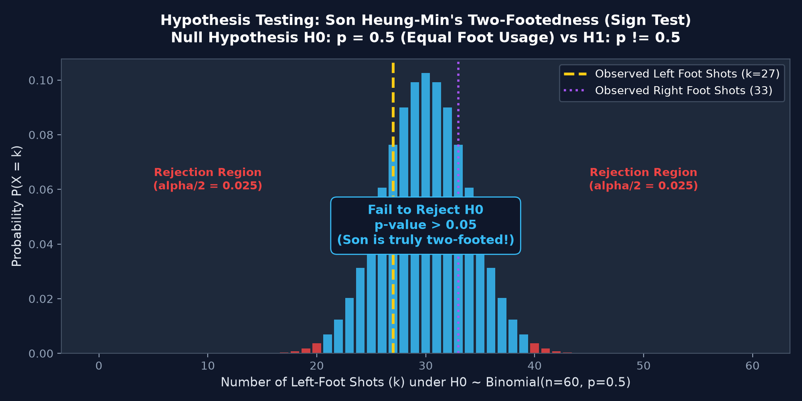

#### Interpretation
If Son shoots $27$ times with his left foot and $33$ times with his right foot out of $n = 60$ shots:
- $k = 27, n = 60$.
- $P(X \le 27) = \sum_{i=0}^{27} \binom{60}{i} (0.5)^{60} \approx 0.2587$.
- Two-tailed $p$-value $= 2 \times 0.2587 = 0.5174$.
- Since $p = 0.5174 > 0.05$, we **fail to reject $H_0$**. Son Heung-Min demonstrates true ambipedality.

---

### Test 2: One-Sample Student's t-Test

#### Research Question
*Does Manchester City create a statistically significantly higher number of corners per match compared to a Premier League benchmark baseline of 6.0 corners per match?*

#### Mathematical Formulation
Let $X$ denote the number of corners taken by Manchester City in a match.
- Sample Size: $n$ matches.
- Sample Mean: $\bar{x} = \frac{1}{n} \sum_{i=1}^n x_i$.
- Sample Variance: $s^2 = \frac{1}{n - 1} \sum_{i=1}^n (x_i - \bar{x})^2$.
- Sample Standard Deviation: $s = \sqrt{s^2}$.
- Hypothesized Population Mean: $\mu_0 = 6.0$.

Hypotheses:
$$H_0: \mu = 6.0 \quad \text{(City averages 6 corners per match)}$$
$$H_1: \mu \neq 6.0 \quad \text{(City averages significantly different from 6 corners; two-tailed)}$$
*(Or one-tailed $H_1: \mu > 6.0$)*

The **t-statistic** measures how many standard errors the sample mean lies away from $\mu_0$:
$$t = \frac{\bar{x} - \mu_0}{\frac{s}{\sqrt{n}}}$$
Under $H_0$, this statistic follows a Student's t-distribution with degrees of freedom:
$$df = n - 1$$

#### Python Implementation (`Introduction_Wycout.ipynb`)
```python
from scipy.stats import ttest_1samp

# Aggregate total corners won by Manchester City across each match
city_corners = corners_by_game.loc[
    corners_by_game["name"] == "Manchester City", "counts"
]

# Run One-Sample t-test against popmean = 6.0
t_stat, p_val = ttest_1samp(city_corners, popmean=6)
print(f"One-Sample t-test: t = {t_stat:.2f}, p = {p_val:.4f}")

if p_val < 0.05:
    print("Reject H0: Manchester City's corner production differs significantly from 6.0.")
else:
    print("Fail to Reject H0: Cannot conclude City's corner count differs from 6.0.")
```

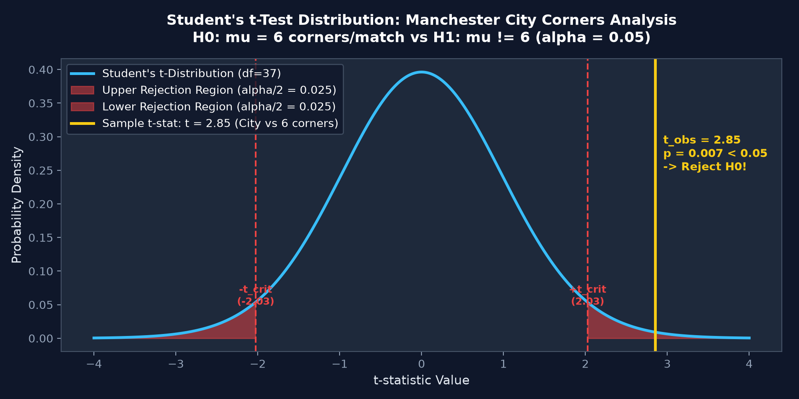

#### Interpretation
If Manchester City plays $n = 38$ matches, averaging $\bar{x} = 7.42$ corners with $s = 3.08$:
$$SE = \frac{s}{\sqrt{n}} = \frac{3.08}{\sqrt{38}} = \frac{3.08}{6.164} \approx 0.50$$
$$t = \frac{7.42 - 6.0}{0.50} = \frac{1.42}{0.50} = 2.84$$
- Degrees of freedom: $df = 37$.
- Two-tailed critical value at $\alpha = 0.05$: $t_{\text{crit}} = \pm 2.026$.
- Since $t = 2.84 > 2.026$ (and $p = 0.007 < 0.05$), we **reject $H_0$**. Manchester City wins significantly more than 6 corners per match.

---

### Test 3: Two-Sample Independent Student's t-Test

#### Research Question
*Is there a statistically significant difference in corner production between Liverpool and Everton across a season (Merseyside Derby comparison)?*

#### Mathematical Formulation
Let:
- Sample 1 (Liverpool): $n_1$ matches, sample mean $\bar{x}_1$, sample variance $s_1^2$.
- Sample 2 (Everton): $n_2$ matches, sample mean $\bar{x}_2$, sample variance $s_2^2$.

Hypotheses:
$$H_0: \mu_1 = \mu_2 \iff \mu_1 - \mu_2 = 0 \quad \text{(No difference in corner creation)}$$
$$H_1: \mu_1 \neq \mu_2 \iff \mu_1 - \mu_2 \neq 0 \quad \text{(Corner production differs)}$$

Assuming equal population variances ($\sigma_1^2 = \sigma_2^2$), we compute the **Pooled Variance ($s_p^2$)**:
$$s_p^2 = \frac{(n_1 - 1)s_1^2 + (n_2 - 1)s_2^2}{n_1 + n_2 - 2}$$
The pooled standard error is:
$$SE_{\bar{x}_1 - \bar{x}_2} = s_p \sqrt{\frac{1}{n_1} + \frac{1}{n_2}}$$
The **Two-Sample t-statistic** is:
$$t = \frac{\bar{x}_1 - \bar{x}_2}{s_p \sqrt{\frac{1}{n_1} + \frac{1}{n_2}}}$$
Under $H_0$, this statistic follows a Student's t-distribution with degrees of freedom:
$$df = n_1 + n_2 - 2$$

> [!TIP]
> If the assumption of equal variances is violated ($s_1^2 \not\approx s_2^2$), use **Welch's t-test** by setting `equal_var=False` in `scipy.stats.ttest_ind`. Welch's test computes degrees of freedom via the Welch–Satterthwaite equation:
> $$df \approx \frac{\left(\frac{s_1^2}{n_1} + \frac{s_2^2}{n_2}\right)^2}{\frac{(s_1^2/n_1)^2}{n_1 - 1} + \frac{(s_2^2/n_2)^2}{n_2 - 1}}$$

#### Python Implementation (`Introduction_Wycout.ipynb`)
```python
from scipy.stats import ttest_ind

liverpool = corners_by_game.loc[corners_by_game["name"] == "Liverpool", "counts"]
everton = corners_by_game.loc[corners_by_game["name"] == "Everton", "counts"]

# Two-sample independent t-test
t_stat2, p_val2 = ttest_ind(liverpool, everton, equal_var=True)
print(f"Two-sample t-test (Liverpool vs Everton): t = {t_stat2:.2f}, p = {p_val2:.4f}")

if p_val2 < 0.05:
    print("Reject H0: Significant tactical difference in corners created between Liverpool and Everton.")
else:
    print("Fail to Reject H0: No statistically significant difference in corner production.")
```

#### Tactical & Analytical Implications
In modern tactical systems, corner kicks correlate strongly with:
- **Field Tilt & Territory:** Teams that consistently pin opponents in their defensive third generate deflected crosses and blocked clearances resulting in corners.
- **Crossing Frequency & Wing Play:** Direct wing-heavy systems generate higher corner counts than narrow possession systems.

---

## 7. Comprehensive Practice Problems & Exam Preparation

### Conceptual Questions

#### Q1: Why do tabular event dataframes contain an overwhelming majority of `NaN` values? Is this a data quality flaw?
**Model Answer:**  
No, it is not a data quality flaw. Football event logs record distinct, polymorphic actions on the pitch. While universal columns (`timestamp`, `team`, `player`, `location`) apply to all events, domain-specific attributes are mutually exclusive. For instance, a `Shot` possesses attributes such as `shot_outcome`, `shot_technique`, and `shot_statsbomb_xg`, whereas a `Pass` possesses `pass_length`, `pass_angle`, and `pass_recipient`. When unnested into a unified two-dimensional relational table, non-applicable columns remain empty (`NaN`).

#### Q2: Contrast Event Data and Tracking Data across frequency, storage footprint, and tactical utility.
**Model Answer:**  
- **Event Data:** Discrete, logged only when an on-ball action occurs ($\approx 3,000$ rows per match, $\approx 3$ MB). Used primarily for action evaluation, shot maps, passing sonars, and Expected Goals ($xG$). It is blind to the remaining 21 players off the ball.
- **Tracking Data:** Continuous, sampled at 10 Hz to 25 Hz ($\approx 3.5$ million records per match, $\approx 2$ GB). Captures coordinates for all 22 players and the ball throughout the match. Used for spatial modeling, pitch control, pressing intensity, line compactness, and physical running metrics.

#### Q3: What is StatsBomb 360 data, and how does it bridge the gap between event and full tracking data?
**Model Answer:**  
StatsBomb 360 data provides a discrete contextual snapshot ("freeze frame") at the exact timestamp of an on-ball event. It extracts the $(x, y)$ coordinates of all visible teammates and opponents inside the broadcast camera view, along with the polygon boundary (`visible_area`). While it does not offer continuous 25 Hz tracking across all 90 minutes, it provides rich spatial context for passing lanes, defensive pressure, and defensive line compactness at a fraction of the cost of optical tracking.

#### Q4: Why must we flip the coordinates of the away team when visualizing both teams on a single pitch plot?
**Model Answer:**  
In raw event datasets, coordinate systems standardize all shots such that teams attack left-to-right (towards $x = 120$ in StatsBomb). Plotting both teams simultaneously without transformation causes both home and away shots to crowd into the same goal mouth. Inverting the away team's coordinates ($x_{\text{new}} = 120 - x_{\text{old}}$) re-establishes the realistic spatial representation where the home team attacks left-to-right and the away team attacks right-to-left.

---

### Code & Data Debugging Exercises

#### Problem 1: Unpacking Coordinates
A student writes the following snippet to parse event locations, but encounters `TypeError: 'float' object is not subscriptable` when filtering shots:
```python
# Buggy code
events['x'] = events['location'].apply(lambda loc: loc[0])
events['y'] = events['location'].apply(lambda loc: loc[1])
```
*Identify the bug and provide the corrected code.*

**Solution:**  
Certain events (e.g., tactical substitutions, yellow cards shown on the bench) have `location = NaN` (which Pandas parses as a `float`). Calling `loc[0]` on a `float` raises a `TypeError`.  
**Corrected implementation:**
```python
events['x'] = events['location'].apply(
    lambda loc: loc[0] if isinstance(loc, list) and len(loc) == 2 else np.nan
)
events['y'] = events['location'].apply(
    lambda loc: loc[1] if isinstance(loc, list) and len(loc) == 2 else np.nan
)
```

#### Problem 2: WyScout Tag Filtering
A researcher attempts to filter left-footed shots in WyScout data using:
```python
# Buggy code
left_shots = shots[shots['tags'] == 401]
```
*Explain why `left_shots` returns 0 rows and write the corrected Pandas expression.*

**Solution:**  
In WyScout JSON, `tags` is a list of dictionaries (e.g., `[{'id': 401}, {'id': 1801}]`), not an integer scalar. Direct equality comparison fails for every row.  
**Corrected implementation:**
```python
left_shots = shots[shots['tags'].apply(
    lambda tag_list: any(isinstance(t, dict) and t.get('id') == 401 for t in tag_list)
)]
```

---

### Mathematical & Statistical Problems

#### Problem 3: Manual Calculation of the Sign Test
A striker attempts $n = 16$ shots across a tournament. The performance analyst logs:
- Left-foot shots: $k = 3$
- Right-foot shots: $n - k = 13$

Test the hypothesis $H_0: p = 0.5$ against the two-sided alternative $H_1: p \neq 0.5$ at significance level $\alpha = 0.05$. Show the full binomial probability sum.

**Step-by-step Solution:**
1. Under $H_0: p = 0.5$, $X \sim \text{Binomial}(n = 16, p = 0.5)$.
2. Calculate the one-tailed cumulative probability $P(X \le 3)$:
   $$P(X = 0) = \binom{16}{0} (0.5)^{16} = \frac{1}{65536} \approx 0.000015$$
   $$P(X = 1) = \binom{16}{1} (0.5)^{16} = \frac{16}{65536} \approx 0.000244$$
   $$P(X = 2) = \binom{16}{2} (0.5)^{16} = \frac{120}{65536} \approx 0.001831$$
   $$P(X = 3) = \binom{16}{3} (0.5)^{16} = \frac{560}{65536} \approx 0.008545$$
3. Sum the lower tail:
   $$P(X \le 3) = 0.000015 + 0.000244 + 0.001831 + 0.008545 = 0.010635$$
4. Compute the two-tailed $p$-value:
   $$\text{Two-tailed } p\text{-value} = 2 \times P(X \le 3) = 2 \times 0.010635 = 0.02127$$
5. **Conclusion:** Since $p = 0.0213 < \alpha = 0.05$, we **reject $H_0$**. The player exhibits a statistically significant preference for the right foot.

#### Problem 4: One-Sample Student's t-Test Computation
Over $n = 25$ matches, Arsenal wins a sample mean of $\bar{x} = 6.80$ corners per match with a sample standard deviation $s = 2.00$.
Test whether Arsenal's corner production is significantly higher than the league average $\mu_0 = 5.80$ at $\alpha = 0.05$ (two-tailed test).

**Step-by-step Solution:**
1. Hypotheses: $H_0: \mu = 5.80$ vs. $H_1: \mu \neq 5.80$.
2. Compute Standard Error ($SE$):
   $$SE = \frac{s}{\sqrt{n}} = \frac{2.00}{\sqrt{25}} = \frac{2.00}{5} = 0.40$$
3. Compute t-statistic:
   $$t = \frac{\bar{x} - \mu_0}{SE} = \frac{6.80 - 5.80}{0.40} = \frac{1.00}{0.40} = 2.50$$
4. Determine Degrees of Freedom and Critical Value:
   $$df = n - 1 = 25 - 1 = 24$$
   From the Student's t-table for $df = 24$ at two-tailed $\alpha = 0.05$:
   $$t_{\text{crit}} = \pm 2.064$$
5. **Decision:** Since $|t| = 2.50 > 2.064$, the $p$-value is less than $0.05$ ($p \approx 0.0197$). We **reject $H_0$**. Arsenal creates significantly more corners than the benchmark.

---

### Tactical & Research Scenarios

#### Scenario 1: Broadcast Camera Frustum Selection Bias
*A data science intern evaluates high-press efficiency by calculating the distance between the defending team's furthest defender and the opponent's striker using StatsBomb 360 data. Why might this metric be systematically biased?*

**Model Answer:**  
StatsBomb 360 freeze frames are derived from broadcast camera footage. When play is concentrated in the opponent's defensive third, the camera zooms into the ball carrier and immediate defenders. Deep central defenders who stay behind the halfway line may be outside the `visible_area` polygon. Treating the furthest observed player in the frame as the team's true deepest defender creates a **camera-induced truncation artifact (selection bias)**, falsely overestimating the team's high defensive line.

---

## 8. References & Supplementary Reading

1. **Textbooks & Core Literature:**
   - David Sumpter, *Soccermatics: Mathematical Adventures in the Beautiful Game*, Bloomsbury Sigma, 2016.
   - Christoph Carling, A. Mark Williams, Thomas Reilly, *Handbook of Soccer Match Analysis*, Routledge, 2005.
2. **Open Data Documentation & Code Repositories:**
   - [StatsBomb Open Data GitHub Repository](https://github.com/statsbomb/open-data)
   - [StatsBombpy Official Python API Documentation](https://github.com/statsbomb/statsbombpy)
   - [WyScout Open Data Ecosystem (Pappalardo et al., Nature Scientific Data, 2019)](https://www.nature.com/articles/s41597-019-0247-7)
   - [mplsoccer: Pitch Plotting & Football Visualization Library](https://mplsoccer.readthedocs.io/)
3. **Academic Lecture Series:**
   - [Mathematical Modelling of Football (Prof. David Sumpter, Uppsala University / YouTube)](https://www.youtube.com/playlist?list=PLczqL_B_j6m-X3GgS6tq83U0zG45Teq4k)
   - [Welcome to Soccermatics Documentation](https://soccermatics.readthedocs.io/)
